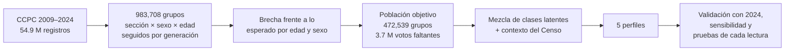
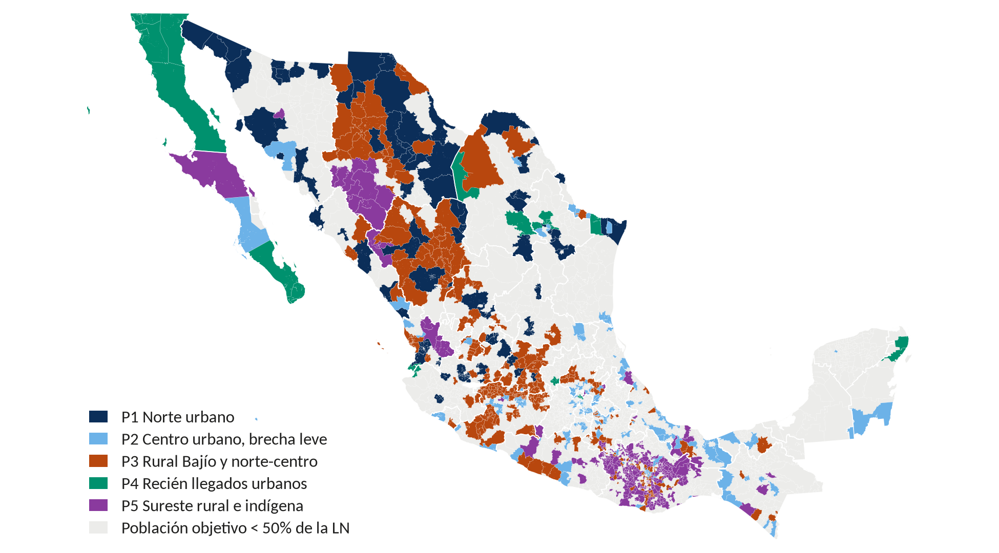
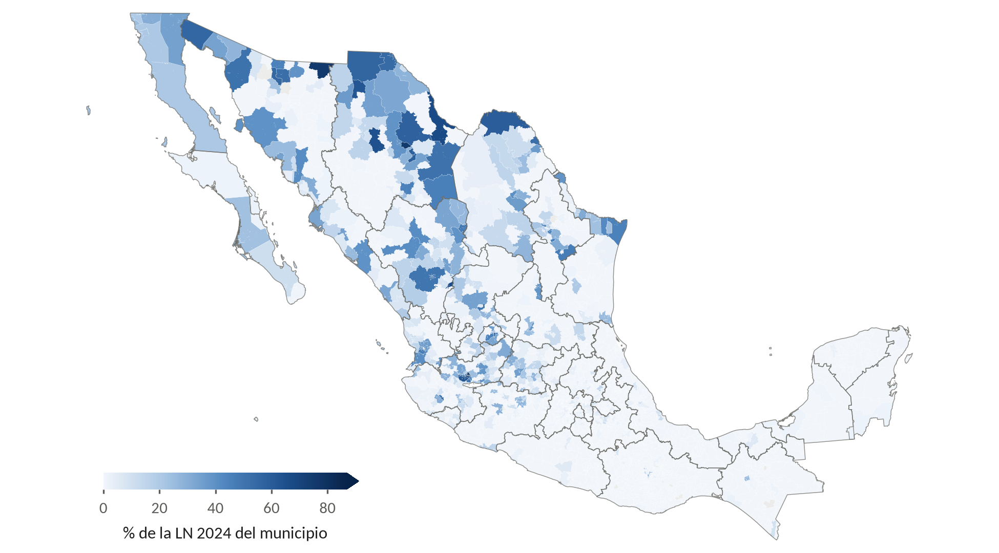
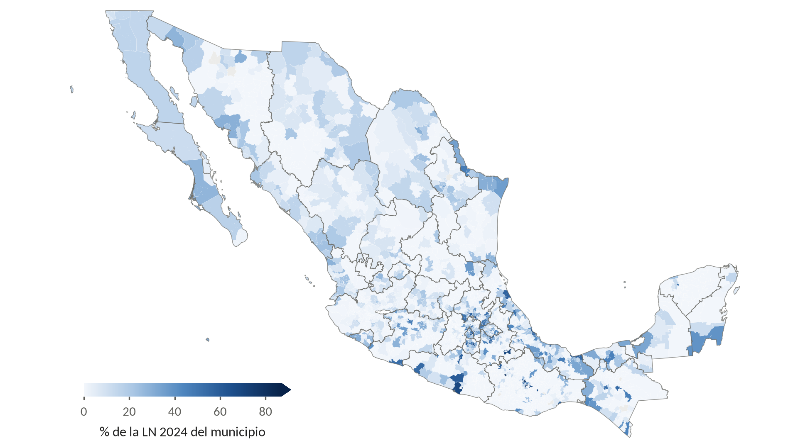
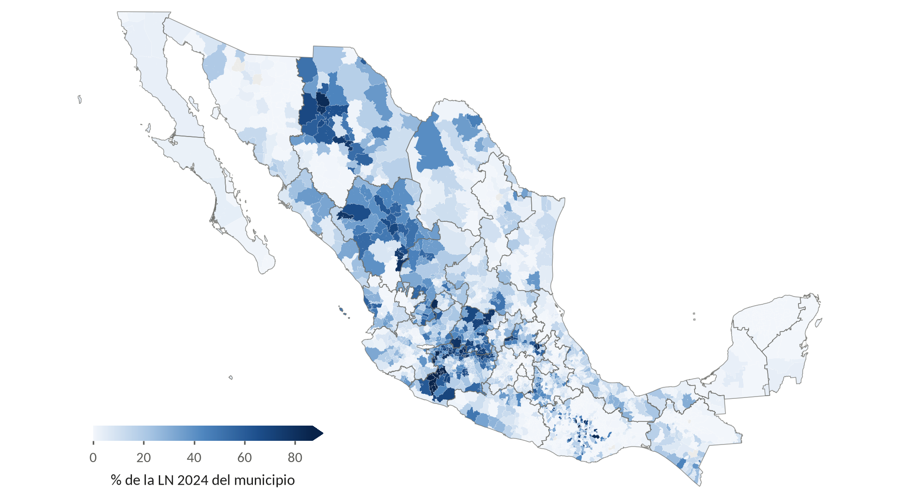
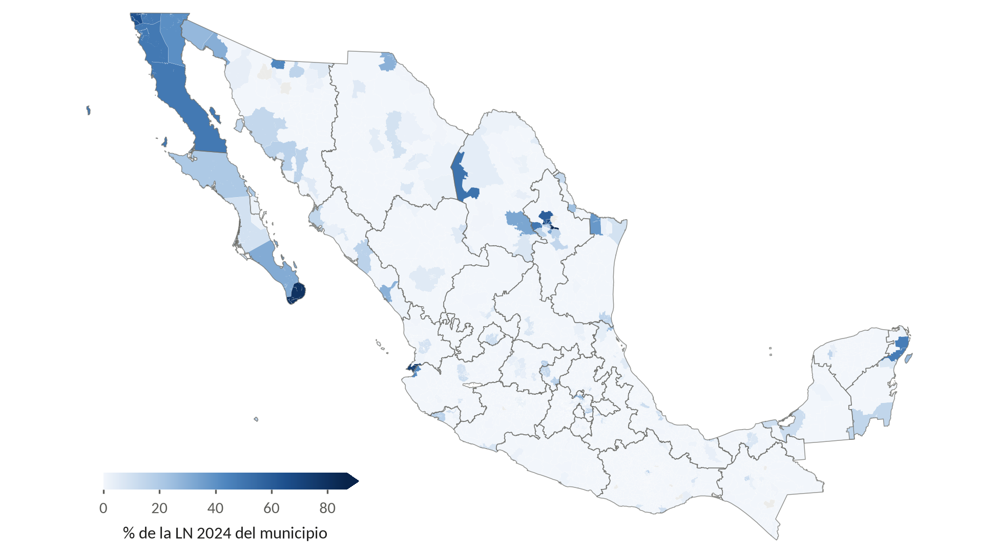
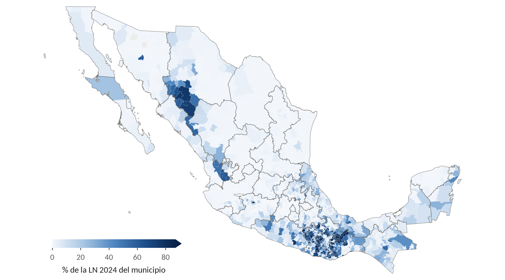
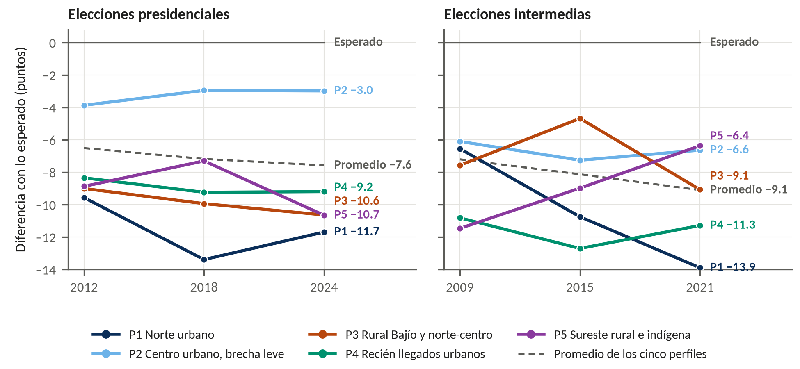
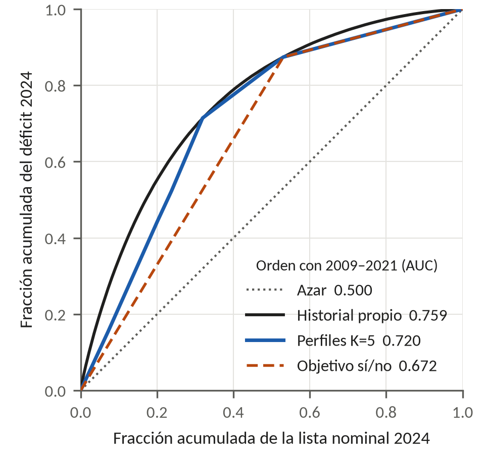

<div align="center">

# Los votos que faltan

### Cinco perfiles para saber dónde buscarlos

**Hackathon INE 2026 · *Hackea la participación* · Reto 1: Perfiles ciudadanos de participación**

Equipo **Los Bien Dotados** · Facultad de Ciencias de la Computación, BUAP<br>
J. A. Pomares Valdés · V. J. López Martínez · L. E. Ramiro Luna · L. G. Olivares Soto (asesor)


[Documento técnico](entregables/documento_tecnico.pdf) · [Fichas de perfil](entregables/fichas_de_perfil.pdf) · [Presentación](entregables/presentacion_ejecutiva.pptx) · [Metodología](docs/METODOLOGIA.md) · [Arquitectura](docs/ARQUITECTURA.md)

</div>

---

## En cifras

<div align="center">

| 🗳️ **3.7 millones** | 👥 **50.7 millones** | 🔁 **72%** | 🧩 **5 perfiles** |
|:---:|:---:|:---:|:---:|
| votos que dejan de emitirse en cada elección federal, frente a lo esperado por edad y sexo | electores (52% de la lista nominal) en grupos que votan menos de lo esperado | de esos grupos siguen por debajo en 2024 (la base es 48%): es un patrón, no un accidente | estables, distintos del azar y ubicables en el mapa |

</div>

Con los Conteos Censales de Participación Ciudadana (CCPC) se reconstruyó el historial de voto de **983,708 grupos** sección × sexo × edad en seis elecciones federales (2009–2024). Cada grupo se comparó con la participación nacional de su misma edad y sexo; los que votan por debajo de lo esperado se dividieron en cinco perfiles.

> **La propuesta tiene dos piezas:** el historial de cada sección dice **dónde** invertir y el perfil dice **a quién** hablarle y **cómo**.

## Cómo se construyeron



## Dónde están

<div align="center">

<br><sub>Perfil con más peso en cada municipio donde la población objetivo es la mayoría de la lista nominal.</sub>
</div>

## Los cinco perfiles

| | Perfil | % del déficit | Estabilidad | Sigue debajo en 2024 | Rasgos de sus secciones |
|:---:|---|:---:|:---:|:---:|---|
| 🔵 | **P1 · Norte urbano** | **30.4%** | 0.89 | 89% | Circunscripción 1; la brecha más grave y la única que se agrava en cada elección (de −6.6 a −13.9 puntos entre 2009 y 2021) |
| 🩵 | **P2 · Centro urbano, brecha leve** | **26.5%** | 0.94 | 54% | El más extenso (40% de la LN objetivo); casi alcanza lo esperado en las presidenciales y se aleja en las intermedias |
| 🟠 | **P3 · Rural del Bajío y norte-centro** | **17.9%** | 0.94 | 82% | 7.5 años de escolaridad y 26% de hogares con internet; los hombres de 25–46 votan menos que las mujeres de su edad |
| 🟢 | **P4 · Recién llegados urbanos** | **16.3%** | 0.86 | 85% | 36% nacieron en otra entidad; 10.3 años de escolaridad y 68% con internet |
| 🟣 | **P5 · Sureste rural e indígena** | **8.8%** | 0.91 | 72% | 10.3% habla lengua indígena, 16% tiene internet y 6.7 años de escolaridad |

<sub>**% del déficit:** parte de los votos faltantes que concentra el perfil. **Estabilidad:** Jaccard medio en el bootstrap de secciones (≥ 0.85 = muy estable). **Sigue debajo en 2024:** grupos del perfil, definidos solo con 2009–2021, que siguen por debajo de lo esperado en 2024. Los rasgos describen las secciones donde se concentra el perfil, no a las personas.</sub>

<table>
<tr>
<td width="50%" align="center"><b>P1 · Norte urbano</b><br></td>
<td width="50%" align="center"><b>P2 · Centro urbano, brecha leve</b><br></td>
</tr>
<tr>
<td align="center"><b>P3 · Rural del Bajío y norte-centro</b><br></td>
<td align="center"><b>P4 · Recién llegados urbanos</b><br></td>
</tr>
<tr>
<td align="center"><b>P5 · Sureste rural e indígena</b><br></td>
<td align="center" valign="middle"><sub>Cada mapa muestra qué porcentaje de la lista nominal 2024 del municipio pertenece al perfil. La escala es la misma en los cinco mapas.</sub></td>
</tr>
</table>

### Cada perfil se aleja de lo esperado a su manera

<div align="center">

</div>

La brecha se mide en puntos de participación frente a lo esperado para la edad y el sexo de cada grupo. P1 se hunde elección tras elección; P2 casi alcanza lo esperado en las presidenciales, pero se aleja en las intermedias; P5 mejora en las intermedias y cae en 2024.

## Qué tan sólidos son

<table>
<tr>
<td width="45%"></td>
<td>

**Anticipan 2024.** Ajustados solo con 2009–2021, los perfiles concentran el déficit de 2024 mejor que la regla simple "objetivo sí/no".

| Orden con 2009–2021 | AUC |
|---|:---:|
| Historial propio de cada sección | **0.759** |
| Perfiles K=5 | **0.720** |
| Objetivo sí/no | 0.672 |
| Azar | 0.500 |

Perfiles − objetivo sí/no: **+0.048** (IC 95% por municipio [0.040, 0.057]).<br>
Historial − perfiles: **+0.039** [0.034, 0.044]. Por eso el historial decide *dónde* y el perfil decide *a quién*.

</td>
</tr>
</table>

| Prueba | Resultado |
|---|---|
| ✅ **Estabilidad** | Los cinco perfiles son "muy estables" (Jaccard 0.855–0.944 en 20 réplicas bootstrap de secciones) |
| ✅ **Contra el azar** | La solución supera las 19 permutaciones de datos barajados (p = 0.05); con seis perfiles el ajuste ya no repite su óptimo, así que cinco es el límite que sostienen los datos |
| ✅ **Gubernatura concurrente** | Con la gubernatura dentro de lo esperado se conserva el 96% de la LN objetivo y cada perfil reaparece con 89–99% de su peso |
| ✅ **Votos no especificados** | Con el NS contado como voto o como abstención se conserva el 91% y el 90% de la LN objetivo; P2 es el más sensible |
| ⚖️ **Costo del quinto perfil** | Frente a cuatro perfiles, el quinto cuesta −0.010 de AUC [−0.013, −0.006] y separa un grupo con estrategia propia (P4) |
| 📍 **Violencia** | Dentro del modelo empeora la anticipación de 2024 (−0.005 de AUC [−0.006, −0.004]); por la regla fijada de antemano queda solo como descriptor |

### Las explicaciones de cada perfil se pusieron a prueba

La lectura de cada perfil es una hipótesis. Se contrastó con pruebas que podían fallar, las mismas 13 para los cinco perfiles, para que ninguna lectura parezca hecha a la medida. Las marcadas con ★ son las que corresponden a la lectura de cada perfil.

| Prueba | P1 | P2 | P3 | P4 | P5 |
|---|:---:|:---:|:---:|:---:|:---:|
| La brecha se agrava en cada elección | ✅★ | ❌ | ✅ | ⚪ | ❌ |
| Más profunda en las intermedias | ❌ | ✅★ | ❌ | ✅ | ⚪ |
| Hombres 25–46 más abajo que mujeres 25–46 | ❌ | ❌ | ✅★ | ❌ | ⚪ |
| Jóvenes 18–24 más abajo que adultos 32–69 | ✅ | ❔ | ❔ | ❔ | ✅★ |
| Personas de 80+ más abajo que adultos 32–69 | ❔ | ❔ | ❔ | ❔ | ❔★ |
| Adultos 25–46 más abajo que adultos 47–69 | ✅ | ❔ | ❔ | ❔★ | ✅ |
| Más profunda donde más gente nació en otra entidad | ✅★ | ⚪ | ❌ | ✅★ | ❌ |
| Más profunda donde llegan más electores | ✅★ | ⚪ | ⚪ | ⚪★ | ⚪ |
| Más profunda donde más se habla lengua indígena | ✅ | ✅ | ⚪ | ✅ | ✅★ |
| Más profunda donde hay menos internet | ✅ | ✅ | ⚪ | ✅ | ✅★ |
| Más profunda donde hay más migración a EE. UU. | ⚪ | ✅ | ⚪★ | ✅ | ✅ |
| Más electores registrados que adultos | ❌ | ✅ | ✅★ | ❌ | ⚪ |
| Más profunda en secciones rurales que urbanas | ⚪ | ⚪ | ❌ | ⚪ | ⚪★ |
| **Pruebas de su lectura que se cumplen** | **3 de 3** | **1 de 1** | **2 de 3** | **1 de 3** | **3 de 5** |

<sub>✅ se cumple · ❌ resultado contrario · ⚪ no se cumple (el intervalo incluye el 0) · ❔ no concluyente (las dos medidas de la brecha no coinciden). Valores e intervalos en [`reports/figuras/figuras_documento/tabla_pruebas.csv`](reports/figuras/figuras_documento/tabla_pruebas.csv).</sub>

La lectura de P4 es la más débil: se reporta así en el documento técnico.

## Entregables

| | Archivo | Contenido |
|:---:|---|---|
| 📄 | [`documento_tecnico.pdf`](entregables/documento_tecnico.pdf) | Documento técnico (12 cuartillas): método, los cinco perfiles con su mapa, sus pruebas y su estrategia |
| 🗂️ | [`fichas_de_perfil.pdf`](entregables/fichas_de_perfil.pdf) | Fichas operativas de cada perfil para el diseño de campañas |
| 📊 | [`presentacion_ejecutiva.pptx`](entregables/presentacion_ejecutiva.pptx) | Presentación ejecutiva (10 diapositivas) |

## Para entender y reproducir el proyecto

| Documento | Contenido |
|---|---|
| [`docs/METODOLOGIA.md`](docs/METODOLOGIA.md) | El método en cinco pasos y cada decisión que cita el código (`D-xxx`) |
| [`docs/ARQUITECTURA.md`](docs/ARQUITECTURA.md) | Estructura del repositorio, cadena de scripts, cómo reproducir y cifras de control |
| [`docs/DATOS.md`](docs/DATOS.md) | Fuentes, enlaces de descarga y dónde va cada archivo |

```bash
make instalar   # entorno con uv (Python 3.12)
make todo       # datos → preparación → perfiles → validación → figuras → pruebas
```

Todas las cifras de esta página salen de [`reports/`](reports/), donde cada script deja sus tablas, sus figuras y sus cifras de control.

<sub>Solo se usan datos agregados y públicos: CCPC del INE, Censo 2020 del INEGI, CONAPO y defunciones del INEGI. No se publica ninguna cifra a nivel de celda.</sub>
